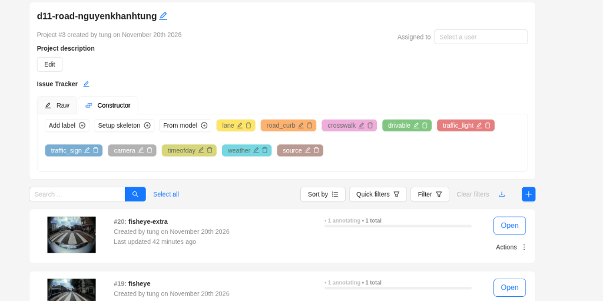
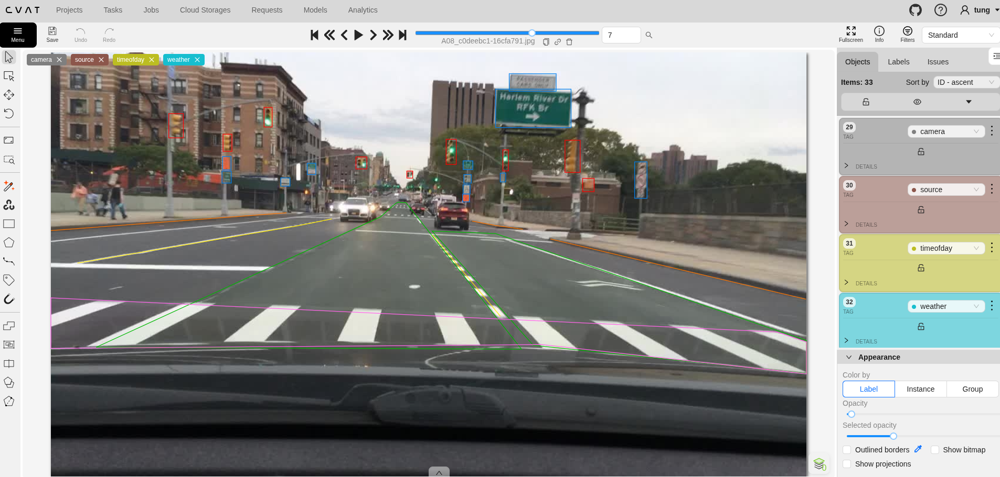
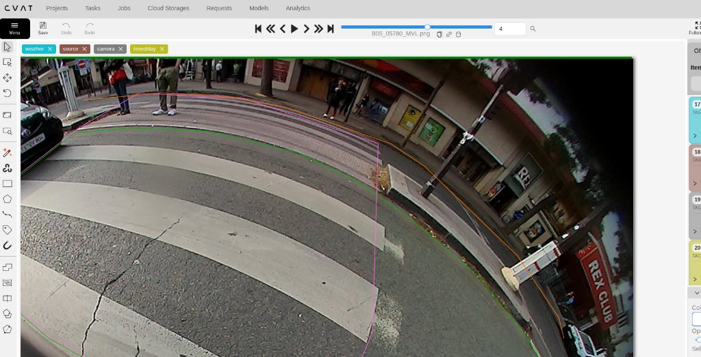

# Báo cáo cá nhân — Ngày 11
Họ tên: Nguyễn Khánh Tùng               Mã học viên: 2A202603144  
Phiên bản CVAT (Help → About): 2.82.0  
Guideline: Road v1.0    Lần nộp (`revision` trong manifest): 2  
Thời điểm export (ngày giờ trên CVAT): 2026-11-21 11:28    Số lần nộp lại sau Rework: 1  

## 1. Kiểm project
| Mục | Đúng như guideline Road v1.0? | Ghi chú |
| --- | --- | --- |
| 6 label, đúng kiểu | Đúng | `lane` (polyline), `road_curb` (polyline), `crosswalk` (polygon), `drivable` (polygon), `traffic_light` (rectangle), `traffic_sign` (rectangle) — khớp `configs/road_v1_labels.json` |
| Thuộc tính và giá trị | Đúng | Đủ các thuộc tính `select` và checkbox `edge_zone` cho đèn/biển; chú ý CVAT tự chọn giá trị đầu tiên (`L1/solid/white/single`, `direct`, `red`) nên phải tự mở Details kiểm lại |
| 4 tag ảnh | Đúng | 4 label kiểu `tag` (`camera`, `timeofday`, `weather`, `source`), mỗi tag có 1 thuộc tính select `value` |
Cách kết thúc polyline trên bản CVAT này: Bấm phím `N` (hoặc click đúp vào điểm cuối / bấm nút `Done` trên thanh công cụ).  
Cách đặt tag ảnh trên bản CVAT này: Chọn công cụ **Tag** ở thanh công cụ bên trái → chọn label tag (`camera`, `timeofday`, `weather`, `source`) → bấm nút **Tag** → mở **Details** trong bảng Objects bên phải để chọn đúng giá trị `value`.  

## 2. Số lượng đã gán
| Task | Ảnh | lane | road_curb | crosswalk | drivable | traffic_light | traffic_sign |
| --- | ---: | ---: | ---: | ---: | ---: | ---: | ---: |
| front | 12 | 24 | 8 | 4 | 24 | 22 | 28 |
| front-extra (đã làm 4 / 4) | 4 | 9 | 0 | 2 | 8 | 9 | 12 |
| fisheye | 8 | 5 | 2 | 11 | 11 | 3 | 9 |
| fisheye-extra (đã làm 4 / 4) | 4 | 0 | 2 | 4 | 4 | 0 | 0 |

## 3. Bảng ca khó
| Ảnh | Nhãn | Phân vân giữa | Đã chọn | Lý do |
| --- | --- | --- | --- | --- |
| A05 | `lane` (`L1`, `R1`) | Vẽ vạch ảo theo mép xe đỗ hay bỏ trống L1/R1 | Không vẽ `lane`, chỉ vẽ `road_curb` + `drivable direct` (chừa dải đỗ xe) | Mặt đường A05 không có sơn vạch kẻ làn; theo `CHECKPOINTS.md`, `SUBMISSION.md` & đặc tả bàn giao mục 2 không tự bịa vạch, giữ bằng chứng xin coach miễn QC1-02 |
| A06 | `lane` (`L1`, `R1`) | Bỏ trống `L1`/`R1` hay vẽ đoạn `L1` ngắn lộ ra sau xe đen | Vẽ 1 polyline tâm vạch cho `L1` (`yellow`, `double`), giữ miễn `R1` | Phía sau chiếc Prius đen có đoạn tim đường vàng đôi nhìn thấy được nên đã bổ sung ở `revision 2`; mép phải sát chân cột thép cầu cạn không có vạch sơn (vệt trắng mờ ở góc dưới-phải nằm ngoài hàng cột thép, thuộc mép ngoài làn đường phụ kế bên chứ không phải `R1` của làn đang đi) nên giữ miễn `QC1-02` |
| A07 | `weather` (tag) | `overcast` hay `rain` | `rain` | Trời nhiều mây nhưng mặt đường ướt bóng và kính lái có giọt nước mưa; theo guideline mục 3, mặt đường ướt rõ do mưa phải gán `rain` |
| A07 | `lane` (`L1`) | Vẽ dọc chân dải bê tông trái hay bỏ trống `L1` | Không vẽ `L1`, giữ `R1` + `drivable` | Dải phân cách bê tông trái không sơn vạch (vệt sáng mảnh sát chân barrier là ánh phản chiếu nước mưa trên mặt đường ướt, không phải vạch sơn); miễn `QC1-02` tương tự `A05` (đã xác nhận cùng người kiểm QC 1) |
| A08 | `traffic_sign` (`PASSENGER CARS ONLY` và cụm biển phụ cột giữa đường) | Gộp chung biển phụ vào hộp biển chính `Harlem River Dr` hay tách hộp | Tách hộp riêng cho `PASSENGER CARS ONLY` (trên biển xanh) và 2 biển phụ cột giữa đường với `group = supplementary` | Theo guideline mục 3, các tấm biển phụ đi kèm biển chính phải vẽ hộp riêng với `group = supplementary` |
| A14 | `lane` (`L1`, `R1`) | Bỏ trống `R1` hay tự vẽ vạch ảo ở mép phải tối | Giữ `L1` tim đường vàng đôi, giữ miễn `R1` | Ảnh đêm (`timeofday = night`), sát vỉa hè/rào công trình bên phải không có vạch sơn kẻ làn nên giữ miễn `QC1-02` cho `R1` tương tự `A06` |
| B03 | `lane` (`R1`, điểm đầu gần cản sau) | Kéo dài `R1` xuống vệt trắng góc dưới-phải theo QC 1 (`QC1-04`) hay giữ nguyên | Giữ nguyên điểm đầu tại `(782.6, 360.6)` | Quan sát kỹ ảnh gốc thấy vệt trắng nhỏ gần cản sau có mép gấp, đổ bóng riêng và lệch phương so với vạch đứt `R1`, giống tờ giấy/rác rơi trên mặt đường hơn là vạch sơn |
| B03, B04 | `lane` (`fisheye_rear`) | Quy ước trái/phải theo góc nhìn khung ảnh hay lật ngược theo đầu xe | Theo trái/phải khung ảnh | Guideline không nêu ngoại lệ đảo ngược cho `fisheye_rear` và khớp mẫu `synthetic.py` của repo |
| B11 | `lane` | Vẽ vạch chéo/vạch ô đỗ người khuyết tật hay bỏ qua | Không gán `lane` lên vạch ô đỗ | Theo guideline mục 4 (fisheye), vạch ô đỗ không gán `lane` (tránh lỗi nặng QC1-03) |

## 4. Phiếu QC 1 nhận được
Bạn kiểm lô của tôi: Phạm Đức Thọ (`2A202603182`, `phamductho`)  Quyết định nhận được: Rework  
| Mã lỗi | Số lỗi | Đồng ý? | Đã sửa? |
| --- | ---: | --- | --- |
| QC1-04 | 1 | Không | Không (giữ nguyên điểm đầu `R1` ở `B03` tại `(782.6, 360.6)` vì vệt trắng gần cản sau có hình dạng/bóng đổ giống tờ giấy hoặc rác trên đường, không phải vệt sơn kẻ làn; đã giải thích ở Mục 3 Bảng ca khó) |
| QC1-06 | 2 | Có | Có (đổi `style` `solid -> dashed` cho `L2` ở `A02` và `R1` ở `B03` ở lần nộp `revision 2`) |
| QC1-07 | 2 | Có | Có (chuyển polygon gán nhầm `crosswalk` `#4` trên làn phải `B03` sang đúng nhãn `drivable` `area_type = alternative`, và bổ sung polygon `crosswalk` bị sót ở `B04` ở lần nộp `revision 2`; đồng thời tự bổ sung thêm `L1` vàng đôi ở `A06`) |

## 5. Kiểm file export
| File | Mở lại được? | Số shape ảnh 1 (job / file) | Số shape ảnh 2 (job / file) | Tag camera có trong XML? |
| --- | --- | --- | --- | --- |
| `nguyenkhanhtung-front.zip` | Có | 8 / 8 | 6 / 6 | Có (đủ ảnh) |
| `nguyenkhanhtung-fisheye.zip` | Có | 3 / 3 | 5 / 5 | Có (đủ ảnh) |

## 6. Ảnh chụp màn hình
1. Tab Labels của project:
   
2. Một ảnh camera trước đã gán đủ (làn, vùng lái, đèn/biển — `A08`):
   
3. Một ảnh fisheye đã gán, phóng to đoạn polyline cong (`B05` — `road_curb` uốn theo cung):
   
4. Một đoạn XML có `<polyline label="lane">`:
```xml
<polyline label="lane" source="manual" occluded="0" points="111.27,720.00;284.68,569.51;337.03,526.17;354.37,512.90;360.74,508.35" z_order="0">
  <attribute name="position">L1</attribute>
  <attribute name="style">dashed</attribute>
  <attribute name="color">white</attribute>
  <attribute name="kind">single</attribute>
</polyline>
```

## 7. Tự đánh giá
Lỗi bạn mắc nhiều nhất hôm nay (theo mã QC1-xx), và cách tránh ở Ngày 20: Hay quên đổi thuộc tính mặc định của CVAT (`style=solid`, `color=red`, `position=L1` → gây `QC1-06`, `QC1-08`), dễ nhầm chiều vẽ polyline từ xa về gần khi tự kiểm (`QC1-04`), cùng lỗi sót/nhầm lớp `crosswalk` (`QC1-07`). Cách tránh ở Ngày 20: luôn đặt điểm đầu polyline từ đáy ảnh/sát xe kéo ra xa, chỉnh ngay `Details` ngay sau khi bấm `N`, và rà lại từng lớp nhãn bằng bộ lọc ẩn/hiện trước khi chuyển ảnh.  
Nhãn của bạn đi vào model ở đâu? Chọn một lỗi đã sửa và nói nó làm model học sai thế nào: Polyline `lane` dùng tạo ground-truth cho bài toán phát hiện làn (như `row-anchor` phục vụ LKA), còn `drivable`/`crosswalk` dùng cho segmentation mặt đường và cảnh báo người đi bộ. Nếu giữ lỗi `QC1-06` (`L2` ở `A02` và `R1` ở `B03` bị gán nhầm `solid` thay vì `dashed`) hoặc `QC1-07` (bỏ sót `crosswalk` ở `B04` và gán nhầm một làn xe `B03` thành `crosswalk`), model phân loại vạch sẽ học nhầm vạch đứt được phép chuyển làn thành vạch liền cấm đè vạch, còn model segmentation/AEB sẽ bỏ sót vạch qua đường ngay sau xe ở `B04` hoặc nhận diện nhầm làn xe đang chạy ở `B03` thành vùng đi bộ.  

## 8. (Tùy chọn, buffer) Từ polyline đến đích row-anchor
| y | 720 | 680 | 640 | 600 | 560 |
| --- | ---: | ---: | ---: | ---: | ---: |
| x của chúng tôi | không có làn | không có làn | 600.9 | 543.2 | 486.4 |
| x của bạn kia | không có làn | không có làn | 601.8 | 543.5 | 485.2 |

Trả lời 3 câu:

1. Năm số x đó chính là đích mà một model row-anchor học cho vạch này. Nếu bạn dừng polyline sớm 40 px, hàng nào đổi thành "không có làn"? Ở đây `A01` `R1` chỉ vẽ tới `y = 676` (đã sớm hơn `680` và `720` nên cả hai hàng này đều `"không có làn"`); nếu rút ngắn thêm 40 px ở đầu gần (`y` giảm từ `676` lên `636`) thì hàng **`y = 640`** sẽ mất giao điểm và đổi thành `"không có làn"` (tương tự nếu dừng sớm 40 px ở đầu xa trên đoạn tới `560`, hàng **`y = 560`** sẽ thành `"không có làn"`).
2. So với bạn được kiểm (cùng ảnh): ở hàng 720 và hàng 560, hai bạn lệch nhau bao nhiêu pixel? Lệch ở hàng nào ảnh hưởng LKA nhiều hơn (slide 25)? Tại `y = 720`, cả hai đều `"không có làn"` (do cùng bắt đầu khoảng `y ≈ 676`); tại `y = 640` lệch `|600.9 - 601.8| = 0.9 px`, tại `y = 560` lệch `|486.4 - 485.2| = 1.2 px`. Về mặt điều khiển giữ làn (LKA), **lệch ở hàng gần xe (`y = 720`) ảnh hưởng nhiều hơn** vì đó là vị trí bánh xe sắp chạm tới ngay trong tích tắc (cận đầu xe), sai lệch vài pixel trực tiếp làm tính sai khoảng cách tới mép làn.
3. Nếu polyline vẽ từ xa về gần (ngược quy tắc 2), cách tính trên có đổi không? Script nào sẽ gặp khó? Công thức nội suy tuyến tính trên từng đoạn (`x_at_y` trong `geometry.py` được gọi bởi `rowanchor.py`) kiểm cả 2 chiều tăng/giảm của `y` nên giá trị số `x` không đổi, nhưng `rowanchor.py` sẽ in cảnh báo ngược chiều, và **`road_check.py`** (so sánh `pts[0]` với điểm gần xe `gt[0]` và kiểm `s1 < s0`) cùng các pipeline học theo thứ tự điểm từ gốc xe ra xa sẽ gặp lỗi hoặc bắt `QC1-04`.
